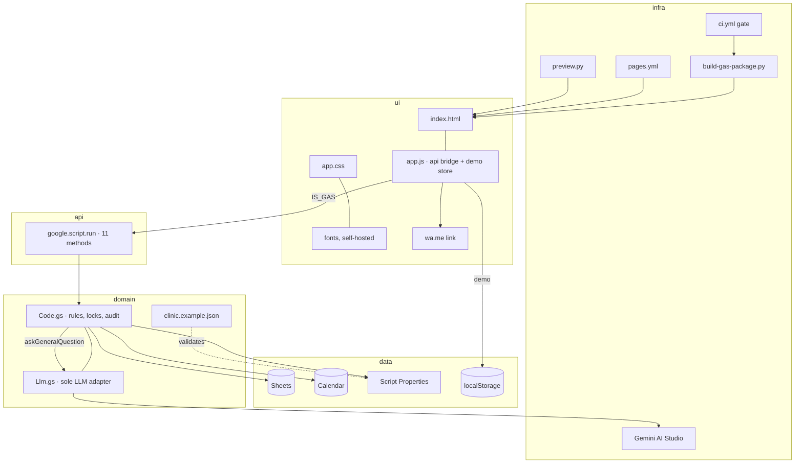
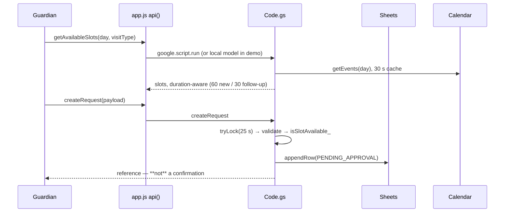
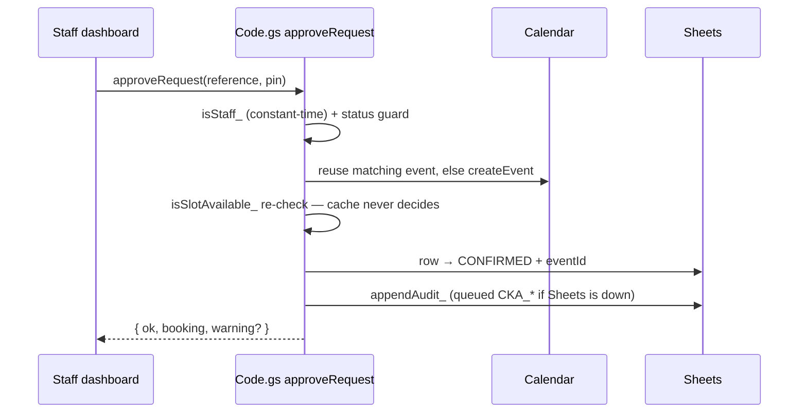

# Architecture — Celia Kids

> `project-map.md` · twin: `docs/map/project.json` (111 nodes · 75 edges, evidence + confidence; counts are the twin's, not a typed number that drifts)
## 1. What it is (L0)

- Arabic (RTL) booking-intake site for **one** paediatric clinic. Principle: **a request is not a confirmation**.
- Collected: guardian name, phone, preferred day/time, visit type. **No medical data, ever.**
- Staff review is the only path to `CONFIRMED`; only then does a Calendar event exist (`Code.gs:258-289`).
- Standalone demo (`localStorage`) and Apps Script mode share one file set; `app.js` swaps only `api()` to `google.script.run`. The assistant (one `gemini` provider) is optional, never on the booking path.
## 2. Run · test · deploy

| Action | Command | Verified |
| --- | --- | --- |
| Run | `python3 scripts/preview.py` → `0.0.0.0:8080` | ✅ 200 `/`; 404 `/gas/`, `/scripts/`, `/.git/` |
| Backend | `node scripts/test-gas-simulated.js` | ✅ exit 0 |
| Adapter | `node scripts/test-llm-adapter.js` | ✅ 15 tests |
| DOM | `test-ui-smoke.js`, `test-demo-availability.js` (`jsdom@25`) | ✅ both pass |
| Contracts | `check-workflows.js --self-test` · `scan-secrets.js` · `env.js` | ✅ 10 cases · 46 files/0 · OK |
| Config | `node scripts/check-config.js [props.json]` | ⚠️ template only, real export untried |
| Build | `python3 scripts/build-gas-package.py` | ✅ 97,089 B + 475,498 B |
| Deploy site | `.github/workflows/pages.yml` | ⚠️ workflow never observed running |
| Deploy backend | paste `gas/` into Apps Script | ⚠️ **never executed** |
| Pilot week | `docs/pilot/professor-week.md` | ⚠️ not run — needs the owner's Google account |
| Growth | `docs/growth/doctors-playbook.md` · `pitch/` | ✅ documents + printed sheet, gated by `check-pilot-docs.js` |
| Google bridge | `test-google-bridge.js` + `google/selftest.js --local` ✅ 29 tests | live bootstrap ⚠️ owner-side |

## 2b. Engineering plane (AI-native, 2026-11 — CELIA-GITHUB-ENGINEERING-STACK-001)

| Gate | File | Trigger | Verified |
| --- | --- | --- | --- |
| CodeQL SAST | `.github/workflows/codeql.yml` | push/PR/weekly | 🆕 runs on this PR; free on public repos |
| OSV vuln scan | `.github/workflows/osv-scan.yml` | push/PR/weekly | SHA-pinned reusable workflow; SARIF → Security tab |
| zizmor (Actions) | `.github/workflows/zizmor.yml` | push/PR/weekly | ✅ 0 findings locally (was 48) |
| OpenSSF Scorecard | `.github/workflows/scorecard.yml` | main/weekly | ⏸ first run after merge |
| Playwright E2E | `e2e/clinic.spec.mjs` + `e2e.yml` | PR | 5 journeys, demo mode only; Chromium on runner |
| Lighthouse CI | `.lighthouserc.json` + `e2e.yml` | PR | a11y ≥0.9 is an error; rest are recorded warnings |
| Release Please | `release-please.yml` (+ manifest/config) | main pushes | opens release PR only; humans merge |
| Renovate / Dependabot | `renovate.json` · `.github/dependabot.yml` | weekly Monday | Renovate = versions (7-day quarantine), Dependabot = security, zero overlap |
| Monthly watch | `.github/workflows/monthly-tools-watch.yml` | 1st of month | opens `[monthly-tools-watch]` issue; deduped while open |

Every action in every workflow is pinned to a full commit SHA (comments carry the tag). `main` protection remains an owner step (integration token: 403 — `scripts/bootstrap-github.sh` corrected to the real check-run name). Full plan, decisions and deviations: `docs/engineering-stack.md`.

## 3. Components

## 4. Flow A — guardian files a request

## 5. Flow B — approval, the only path to CONFIRMED

Move / cancel / complete repeat the shape: lock → status guard → Calendar mutation → row update → best-effort audit (`Code.gs:311-390`).
## 6. Environment & secrets (names only)

| Name | Kind · level | Read by |
| --- | --- | --- |
| `GEMINI_API_KEY` | secret · repo | `live-llm-smoke.js:18`; Script Property for runtime (`Llm.gs:110`) |
| `GROQ_API_KEY` · `CELIA_ADMIN_PIN` | secret · repo / environment:production | nothing (reserved; PIN unused by workflows) |
| `APP_ENV` · `LLM_PRIMARY` · `LLM_SMOKE_ENABLED` | variable · repo | `ci.yml:18-20,135-136` |
| `NODE_VERSION` · `PYTHON_VERSION` | variable · repo | `ci.yml:19`, `pages.yml:26,30`, `setup-status.yml:30` |
| `CELIA_*` ×8 | local mirrors · `.env.example:21-28` | nothing (convention only — gap G4) |
| 24 Script Properties | runtime config | `Code.gs:420-450`, `Llm.gs:83-105` |

Enforced chain: `docs/secrets-manifest.json` → `.env.example` → workflow `secrets.X`/`vars.X` → `check-workflows.js`.
With no `GEMINI_API_KEY` the live smoke job skips and the assistant disables; booking is unaffected.
## 7. External services (Zero-Card)

| Service | Role | Card | Isolated at |
| --- | --- | --- | --- |
| GitHub Pages | static hosting | no | `pages.yml` + `_site/` |
| Google Apps Script | backend runtime | no | `Code.gs` public functions |
| Google Sheets | system of record | no | `*Sheet_`, `readAllRequests_`, `findRequest_` |
| Google Calendar | availability truth | no | `getCalendar_`, `isSlotAvailable_`, `makeDate_` |
| Gemini AI Studio | optional assistant | no | `LLM.PROVIDERS` (`Llm.gs:29`) |
| Groq | reserved fallback | no | not implemented (G9) |

Avoided on purpose (card required): fly.io, Koyeb, AWS, GCP Cloud Run, Azure, Oracle Cloud, Anthropic API — `docs/free-tiers.json`.
## 7b. Google bridge

One boundary: `scripts/google/gateway.js` (`LocalAdapter` default, `GoogleAdapter` for Drive/Sheets/Calendar).
The account is a **profile** (`config/google.profile.<name>.json`, git-ignored) chosen by `GOOGLE_PROFILE`, token name derived (`GOOGLE_REFRESH_TOKEN_<PROFILE>`); no email, raw id or account name in code. Profile now: `dev`, dev/test only. Swap: `docs/google-setup.md` §4, zero code changes.
## 8. Conventions found

- One bridge: `api()` → `callServer()` → `withDeadline()` (`app.js`); every call has a 45 s deadline (`window.CELIA_CALL_TIMEOUT_MS`), and a timed-out write is ambiguous by design: the UI says so and staff screens re-read the dashboard instead of trusting the stale view.
- Every write: `tryLock(25000)` → status guard → re-check availability → mutate → audit → `invalidateSlotCacheFor_(day)`. Config over code; invalid config fails loudly.
- The 30 s availability cache is a quota shield only: any staff action that changes what is bookable drops that day's keys, and approval always re-reads Calendar.
- Staff gate: constant-time PIN check behind a cache-backed attempt limit (`staffPinFailure_`); audit actor is `staff:<signed-in account>`.
- Dependency-free tests (`assert`, `vm` stubs); jsdom ad hoc, never declared. Arabic UI, non-medical, Arabic-Indic numerals.
## 9. Top 10 gaps

| # | Sev | Gap |
| --- | --- | --- |
| G1 | high | Backend never ran in a real Google account; Sheets/Calendar/locks/audit only vm-simulated. |
| G2 | high | `main` unprotected, 0 secrets, 0 variables — declared setup never applied. |
| G3 | high | `GEMINI_TIMEOUT_MS` read at `Llm.gs:113`, absent from `config/clinic.example.json` → unprevalidated. |
| G4–G9 | med | Closed: `CELIA_*` mirrors documented, availability parity gate, dead root build script removed, foreign files gone, `GROQ_API_KEY` declared-only on purpose. |
| G10–G13 | low | Closed: jsdom absence fails the suite, demo PIN hint is demo-only, docs drift fixed, actionlint/gitleaks are pinned and fatal now. |
| G14 | med | Google bridge code-complete but never bootstrapped on a real account. |
| G15 | high | Availability cache survived staff actions: an approved, moved or closed time stayed on offer for up to 30 s. Fixed (`invalidateSlotCacheFor_`). |
| G16 | high | Staff PIN gate answered wrong PINs forever. Fixed (5 failures → 15-minute lock in the script cache). |
| G17 | med | Audit rows said only "staff". Fixed (`staffActor_()` records the signed-in account). |

Open gaps are G1, G2 and G14; the rest are closed with evidence. Full list: `docs/map/gaps.json`.
## 10. Glossary

- **Request** → `PENDING_APPROVAL`; **approval** creates the Calendar event and flips it to `CONFIRMED`.
- **Demo mode** — no `google.script.run`: `localStorage`, PIN `2468`, never a confirmation. **Queues** — `CKQ_*`/`CKA_*` buffer failed writes. **Profile** — account selector, never in code.
